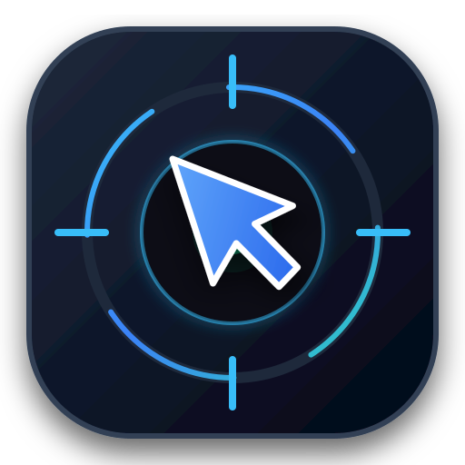

<div align="center">

  

  # UniClick

  **Modern, Multi-Target Sequential Auto Clicker with Draggable Screen Reticles & Multi-Monitor Intelligence**

  <p align="center">
    
    
    
    
    
  </p>

  <p align="center">
    <a href="#-key-features">Key Features</a> •
    <a href="#-quick-start">Quick Start</a> •
    <a href="#-keyboard-shortcuts">Shortcuts</a> •
    <a href="#-core-architecture">Architecture</a> •
    <a href="#-building-from-source">Build</a> •
    <a href="#-license">License</a>
  </p>
</div>

---

## 📖 Overview

**UniClick** is a lightweight, customizable desktop auto clicker engineered for sequential multi-target routines and automated workflows. Unlike basic single-coordinate clickers, UniClick lets you visually organize complex automation sequences using interactive, draggable screen reticles ("target pins") that seamlessly cross multiple monitors and DPI boundaries.

Whether you need rapid multi-button routines, precise timed sequences, or unobtrusive background clicking while working on another screen, UniClick provides an intuitive, pleasant user experience with responsive tactile feedback.

---

## ✨ Key Features

<table>
  <tr>
    <td width="50%">
      <h3 align="left">🎯 Draggable Circular Target Pins</h3>
      <ul>
        <li><b>True Circular Window</b>: Transparent outer corners with a solid, 100% draggable interior disc across any screen location.</li>
        <li><b>Visual Pop-In & Pulse Feedback</b>: Smooth scale entrance animation and tactile ripple rings at click coordinates.</li>
        <li><b>Live Floating HUD</b>: Hovering pins reveals live <code>(X, Y)</code> coordinates, label, and step delay tooltip.</li>
        <li><b>Wheel Tuning</b>: Scroll mouse wheel directly over pins to tweak step delays by <code>±0.10s</code>.</li>
      </ul>
    </td>
    <td width="50%">
      <h3 align="left">🖥️ Multi-Monitor Target Intelligence</h3>
      <ul>
        <li><b>Cross-Monitor Snipe Mode</b>: Interactive crosshair HUD tracks your cursor anywhere—simply Left-Click to drop a target.</li>
        <li><b>Per-Monitor DPI V2 Aware</b>: True pixel accuracy across mixed scaling factors (e.g. 100% + 125% DPI setups).</li>
        <li><b>F7 Instant Capture</b>: Hover over any button and press <code>F7</code> to instantly record target coordinates.</li>
        <li><b>Gather Pins</b>: Instantly re-center misplaced pins to your active screen with one click.</li>
      </ul>
    </td>
  </tr>
  <tr>
    <td width="50%">
      <h3 align="left">👻 Anti-Detection & Ghost Click</h3>
      <ul>
        <li><b>Ghost Click Mode</b>: Automates clicks on secondary displays and teleports cursor back to where you were working instantly.</li>
        <li><b>Humanized Pixel Jitter</b>: Randomizes clicks within a configurable radius (<code>±px</code>) so clicks never hit identical pixels.</li>
        <li><b>Time Jitter (±s)</b>: Natural micro-variations on intervals to simulate realistic human timing.</li>
      </ul>
    </td>
    <td width="50%">
      <h3 align="left">🗕 Compact Mini Mode & Dashboard</h3>
      <ul>
        <li><b>Compact Floating Bar (540x88)</b>: Shrinks the application into a minimalist Always-on-Top widget.</li>
        <li><b>Collapsible Settings</b>: Accordion sections with live header summaries for intervals, timer limits, cycles, and logs.</li>
        <li><b>Multi-Action Sequences</b>: Supports Left, Double, and Right clicks, plus Burst repeats (<code>x1..x10</code>) per step.</li>
      </ul>
    </td>
  </tr>
  <tr>
    <td width="50%">
      <h3 align="left">🎨 Color-Triggered Pixel Detection</h3>
      <ul>
        <li><b>Sub-Microsecond GDI Sampling</b>: Ultra-fast native Win32 <code>GetDC</code>/<code>GetPixel</code> (~1.5µs) with zero external dependencies.</li>
        <li><b>Dual Trigger Modes</b>: <i>Queue Mode</i> (waits in sequence indefinitely until color appears) & <i>Instant Sentinel Mode</i> (autonomous background watcher).</li>
        <li><b>Inline Expandable Drawer</b>: Click <code>🎨</code> to configure trigger mode, color, and tolerance directly within sequence cards.</li>
        <li><b>3D Euclidean Color Tolerance</b>: Configurable tolerance slider (<code>0% - 50%</code>, default 30%) with live match indicator.</li>
      </ul>
    </td>
    <td width="50%">
      <h3 align="left">🔍 Precise Color Acquisition</h3>
      <ul>
        <li><b>Cross-Screen Eyedropper Pipet</b>: Floating magnifier overlay tracks cursor across all monitors to sample exact colors.</li>
        <li><b>🎯 Under Pin Sampling</b>: Instantly detects screen color beneath pin coordinates with automatic unobstructed window unmasking.</li>
        <li><b>Optical Reticle Aperture</b>: Pin reticle features a transparent central peep-hole and color indicator pip.</li>
        <li><b>Quick Palette Presets</b>: Instant 1-click selection from 8 base colors (Red, Yellow, Green, Blue, Orange, Purple, White, Black).</li>
      </ul>
    </td>
  </tr>
</table>

---

## ⌨️ Keyboard Shortcuts

| Hotkey | Action | Description |
| :---: | :--- | :--- |
| <kbd>F6</kbd> | **Start / Pause** | Toggle execution of the sequential click engine |
| <kbd>F7</kbd> | **Drop Pin at Cursor** | Instantly create a new target pin under your mouse |
| <kbd>Esc</kbd> / <kbd>F8</kbd> | **Emergency Stop** | Immediately halt all click actions and restore pins |
| <kbd>Scroll Wheel</kbd> | **Delay Step (±0.1s)** | Scroll directly over any on-screen reticle pin |
| <kbd>Right Click</kbd> | **Quick Delete** | Right-click directly on any pin to remove it |

---

## 🚀 Quick Start

### Option 1: Standalone Portable Executable (Recommended)
No installation or Python runtime required:
1. Download **`UniClick.exe`** from the [Latest GitHub Release](https://github.com/Plesnamdwa/UniClick/releases).
2. Double-click to launch.

### Option 2: Run from Source

```bash
# 1. Clone this repository
git clone https://github.com/Plesnamdwa/UniClick.git
cd UniClick

# 2. Install dependencies
pip install -r requirements.txt

# 3. Launch application
python main.py
```
*(Or simply double-click `run.bat`)*

---

## 🏗️ Project Structure

```
uniclick/
├── assets/
│   └── logo.svg                 # Vector application branding icon
├── profiles/
│   └── Default Profile.json     # Default profile preset template
├── tests/
│   ├── test_engine.py           # Unit tests (duration, cycles, profiles)
│   └── test_color_trigger.py    # Unit tests for pixel distance, queue & sentinel modes
├── app_ui.py                    # Modern CustomTkinter application GUI with inline drawer
├── engine.py                    # Multi-target sequence clicker core engine & sentinel watcher
├── hotkeys.py                   # Win32 GetAsyncKeyState hotkey manager & audio cues
├── main.py                      # Per-Monitor DPI V2 bootstrap entry point
├── pixel_scanner.py             # Sub-microsecond Win32 GDI pixel sampling & 3D color matching
├── profile_manager.py           # JSON profile schema serializer & migration
├── target_pin.py                # Circular transparent reticle pins & Eyedropper overlay
├── theme.py                     # Unified design token system (T.*)
├── toast.py                     # Non-blocking slide-up toast notification system
├── ui_widgets.py                # Collapsible accordion container widgets
├── build_exe.bat                # One-click PyInstaller standalone compiler
├── requirements.txt             # Python dependency manifest
└── run.bat                      # Quick local launcher script
```

---

## 🔨 Building from Source

To package **UniClick** into a self-contained single `.exe` file without console window:

```bash
python -m PyInstaller --noconsole --onefile --name "UniClick" --collect-all customtkinter main.py
```
*(Or run `build_exe.bat` directly)*. The output binary will be generated in `dist/UniClick.exe`.

---

## 📄 License

Distributed under the **MIT License**. See [`LICENSE`](LICENSE) for more information.
